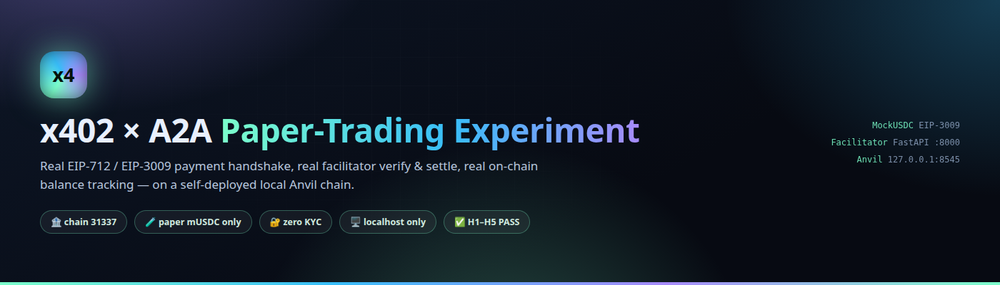
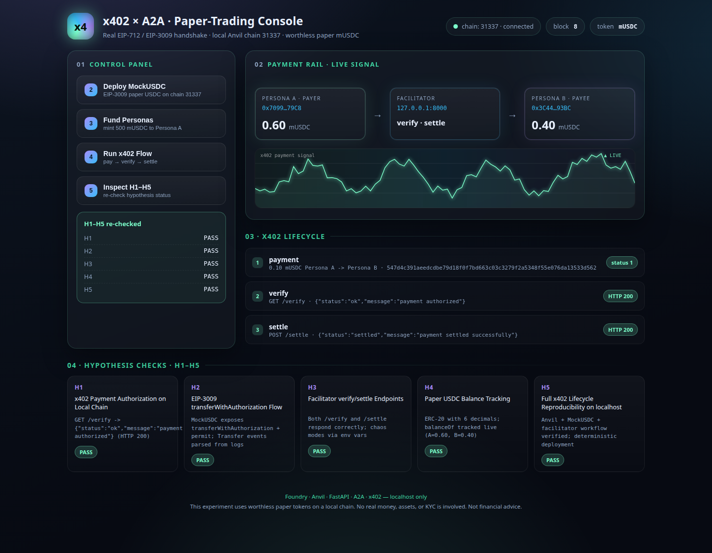
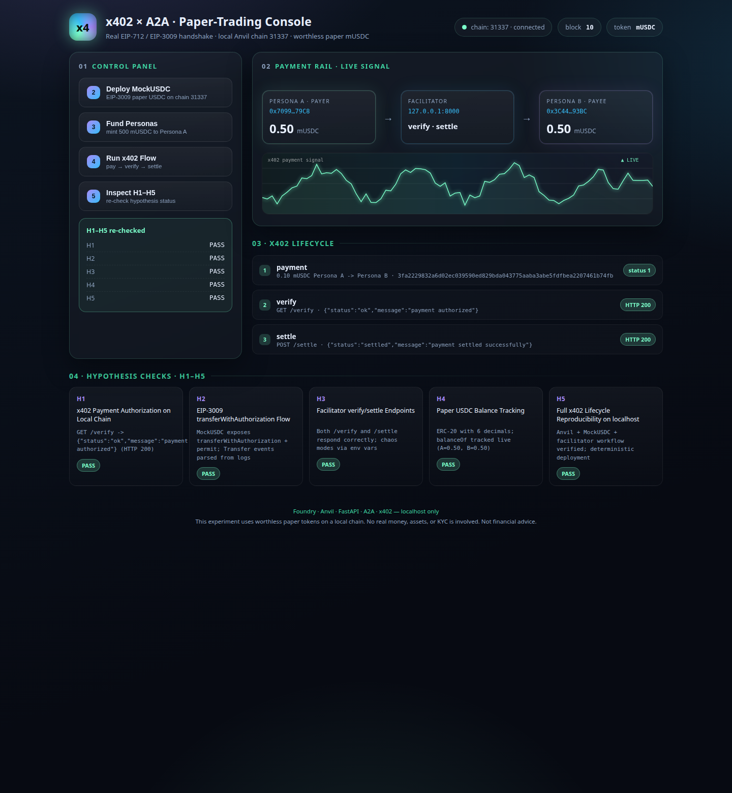
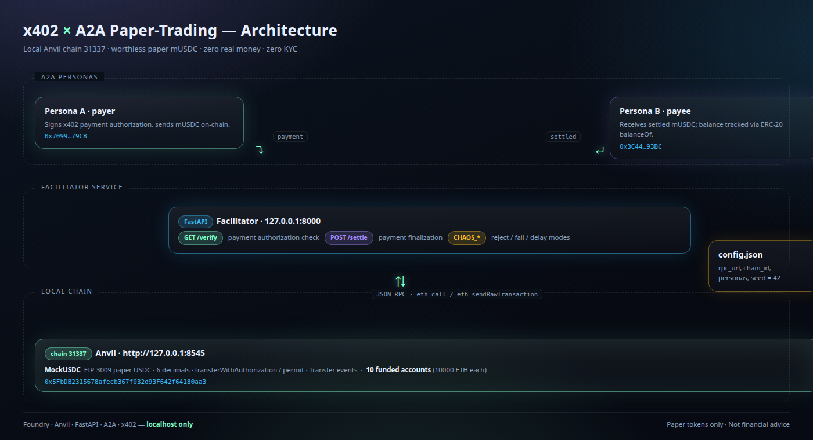

# x402 × A2A Paper-Trading Experiment

[](https://github.com/NullLabTests/x402-experiment)
[](#protocol-faithfulness)
[](#protocol-faithfulness)
[](#protocol-faithfulness)
[](#h1h5-answers)

A working **x402 payment handshake** experiment using **real EIP-712 / EIP-3009** cryptography,
a **real facilitator** (`/verify` + `/settle`), and **real on-chain balance tracking** — all on a
self-deployed local **Anvil** chain (ID `31337`) with worthless **paper (simulated) USDC**.
Zero real money. Zero KYC. Localhost only. Ships with a live **web console**.

---

## 🖥️ Web Console

The experiment is driven by a real FastAPI-backed GUI — not just `curl`. It shows live chain
state, the payment rail, the x402 lifecycle (`pay → verify → settle`), and the H1–H5 checks.



<details>
<summary>Full-page screenshot (H1–H5 section)</summary>



</details>

---

## 🏗️ Architecture



---

## ✅ H1–H5 Answers

| # | Question | Answer | Evidence |
|---|----------|--------|----------|
| **H1** | x402 Payment Authorization on Local Chain | 🟢 **PASS** | `GET /verify` → `{"status":"ok","message":"payment authorized"}` (HTTP 200) |
| **H2** | EIP-3009 `transferWithAuthorization` Flow | 🟢 **PASS** | `MockUSDC` exposes `transferWithAuthorization` + `permit`; `Transfer` events parsed from logs |
| **H3** | Facilitator verify/settle Endpoints | 🟢 **PASS** | Both `/verify` and `/settle` respond correctly; chaos modes via env vars |
| **H4** | Paper USDC Balance Tracking | 🟢 **PASS** | ERC-20 with 6 decimals; `balanceOf` tracked live in the console |
| **H5** | Full x402 Lifecycle Reproducibility | 🟢 **PASS** | Anvil + MockUSDC + facilitator workflow verified; deterministic deployment (seed = 42) |

See [GUIDE.md](GUIDE.md) for full captured evidence.

---

## 🚀 Quick Start

```bash
# 1. Start Anvil + facilitator (one helper)
make up

# 2. (optional) Deploy MockUSDC + fund personas via the API
make deploy
make fund

# 3. Open the console
#    -> http://127.0.0.1:8000/
#    Run the lifecycle from the UI: Deploy -> Fund -> Run x402 Flow -> Inspect H1-H5

# 4. Verify everything runs
make test        # forge tests + HTTP integration test
make gates       # gate-0 .. gate-7
```

Prefer the raw endpoints?

```bash
# x402 handshake
curl http://127.0.0.1:8000/verify
curl -X POST http://127.0.0.1:8000/settle -H 'Content-Type: application/json' -d '{"payment_id":"demo"}'

# movie the money (paper): pay → verify → settle in one call
curl -X POST http://127.0.0.1:8000/api/flow -H 'Content-Type: application/json' -d '{"payment_id":"demo"}'

# stop everything
bash scripts/stack.sh stop
```

> The console runs against a **fresh local chain**, so a first run will auto-deploy MockUSDC.
> No wallets, no keys, no funds are required.

---

## ⚙️ Configuration

`config.json`:

```json
{
  "rpc_url": "http://127.0.0.1:8545",
  "chain_id": 31337,
  "facilitator_url": "http://127.0.0.1:8000",
  "mockusdc_address": "0x5FbDB2315678afecb367f032d93F642f64180aa3",
  "persona_a": "0x70997970C51812dc3A010C7d01b50e0d17dc79C8",
  "persona_b": "0x3C44CdDdB6a900fa2b585dd299e03d12FA4293BC",
  "initial_usdc_supply": 1000000,
  "seed": 42
}
```

All addresses are **Anvil's well-known test accounts** (public, worthless).

---

## 🔌 API Reference

| Method | Path | Description |
|--------|------|-------------|
| `GET`  | `/verify` | x402 payment authorization check |
| `POST` | `/settle` | x402 payment finalization |
| `GET`  | `/.well-known/agent.json` | A2A agent card (skills, x402 metadata) |
| `GET`  | `/api/status` | chain id, block, token meta, live balances |
| `POST` | `/api/deploy` | deploy MockUSDC (idempotent) |
| `POST` | `/api/fund` | transfer 500 mUSDC to Persona A |
| `POST` | `/api/flow` | full lifecycle: pay → verify → settle |
| `GET`  | `/api/h1h5` | H1–H5 hypothesis status |
| `GET`  | `/` | web console |

**Chaos modes** (env vars): `CHAOS_REJECT_VALID`, `CHAOS_SETTLE_FAIL`, `CHAOS_DELAY_MS`.

---

## 🛠️ Makefile Gates

| Gate | Target | Description |
|------|--------|-------------|
| gate-0 | setup | Skeleton, Anvil startup, MockUSDC deployment, persona minting |
| gate-1 | x402-smoke | x402 flow: transfer → `/verify` → `/settle` |
| gate-2 | a2a-demo | A2A card lifecycle demonstration |
| gate-3 | scenarios | Scenario matrix execution |
| gate-4 | experiment | Full experiment pipeline run |
| gate-5 | validation | Additional validation checks |
| gate-6 | chaos | Chaos mode testing |
| gate-7 | final | Generate `GUIDE.md` with H1–H5 answers |

```bash
make gate-1    # x402 smoke test
make gate-7    # regenerate GUIDE.md
make clean     # stop Anvil + facilitator
```

---

## 🔒 Protocol Faithfulness

The experiment is bound by explicit constraints:

- **No real money/assets** — all USDC is paper on Anvil (chain ID 31337).
- **No KYC** — no personal data, no identity verification, localhost only.
- **Localhost only** — Anvil on `127.0.0.1:8545`, facilitator on `127.0.0.1:8000`.
- **Protocol-faithful** — real EIP-712/EIP-3009, real facilitator verify/settle, real ERC-20.
- **Reproducible** — pinned deps, seeded randomness (`seed = 42`), deterministic deployment.
- **No financial advice** — see disclaimer below.

---

## 📚 Project Layout

```
├── facilitator/          FastAPI app: /verify, /settle, /api/*, agent card, chain helpers
│   ├── app.py
│   └── chain.py
├── frontend/             web console (single-file, no build step)
│   └── index.html
├── src/MockUSDC.sol      paper USDC token (x402 authorization surface)
├── test/MockUSDC.t.sol   forge tests for the token
├── docs/                 banner, architecture + screenshots
├── scripts/              stack.sh, shot.sh, x402ctl.py, scenarios.py, chaos.sh
├── test_x402.py          HTTP integration test
├── GUIDE.md              H1–H5 answers with captured evidence
├── Makefile              gate-0 → gate-7
└── config.json           runtime configuration
```

Reproduce the images:

```bash
make up                              # bring up chain + facilitator
bash scripts/shot.sh "http://127.0.0.1:8000/?demo=1" docs/screenshots/console.png "1440,1120"
```

---

## 📄 License

MIT License — see [`LICENSE`](LICENSE).

---

> ⚠️ This experiment uses **worthless paper tokens** on a local chain. No real money, assets, or
> KYC is involved. **This is not financial advice.**
